# Jarkom-Modul-5-2026-K-37

| Nama | NRP |
|:---:|:---:|
| Azfaro Zid Ilmi | 5027251018 |
| Gede Satya Putra Aryanta | 5027251012 |

---

## Daftar Isi

- [Tabel Pembagian Interface & Alamat IP](#tabel-pembagian-interface--alamat-ip)
- [soal 1 - Azfaro](#soal-1--vlsm)
- [soal 2 - Azfaro](#soal-2--ip-router-dan-ip-forwarding)
- [soal 3 - Azfaro](#soal-3--routing-statis-dengan-rute-minimal)
- [soal 4 - Azfaro](#soal-4--nat-dan-dns)
- [soal 5 - Azfaro](#soal-5--firewall-gendou)
- [Soal 6 — IP statis permanen](#soal-6--ip-statis-permanen)
- [Soal 7 — Layanan MAGI](#soal-7--layanan-magi)
- [soal 8 - Satya](#soal-8)
- [soal 9 - Azfaro](#soal-9--sabotase-routing-di-shigeru)
- [soal 10 - Azfaro](#soal-10--sabotase-nat-di-misato-dan-gendou)
- [soal 11 - Satya](#soal-11)
- [soal 12 - Satya](#soal-12)
- [soal 13 - Satya](#soal-13)
- [soal 14 - Satya](#soal-14)
- [soal 15 - Satya](#soal-15)
- [soal 16 - Satya](#soal-16)
- [soal 17 - Satya](#soal-17)
- [soal 18 - Azfaro](#soal-18--gerbang-monolith-dan-radar-shigeru)
- [soal 19 - Azfaro](#soal-19--isolasi-armisael)
- [soal 20 - Satya](#soal-20)

---

## Tabel Pembagian Interface & Alamat IP

| Item | Nilai |
|---|---|
| Project GNS3 | `K-37-MODUL-5` |
| Base network | `10.82.0.0/16` (terpakai `10.82.0.0` – `10.82.4.171`) |
| Image | `ardhptr21/debinet:latest` |
| Router pusat | **Gendou** (`eth0` → NAT1, DHCP) |
| DNS | `192.168.122.1` (didapat Gendou dari DHCP NAT1) |

| Router | eth0 | eth1 | eth2 | eth3 | eth4–eth8 |
|:---|:---|:---|:---|:---|:---|
| Gendou | DHCP (NAT1) | 10.82.4.105/30 | 10.82.4.109/30 | 10.82.4.113/30 | .117, .121, .125, .129, .133 (/30) |
| Yui | 10.82.4.114/30 | 10.82.3.1/25 | 10.82.4.137/30 | 10.82.4.141/30 | eth4 10.82.4.145/30 |
| Fuyutsuki | 10.82.4.110/30 | 10.82.4.57/29 | 10.82.4.149/30 | 10.82.4.153/30 | |
| Asuka | 10.82.4.122/30 | 10.82.4.97/30 | 10.82.4.157/30 | 10.82.4.161/30 | |
| Hikari | 10.82.4.118/30 | 10.82.2.1/24 | 10.82.4.165/30 | | |
| Shigeru | 10.82.4.134/30 | 10.82.4.81/29 | 10.82.4.169/30 | | |
| Kaji | 10.82.4.126/30 | 10.82.4.101/30 | | | |
| Misato | 10.82.4.130/30 | 10.82.4.65/29 | | | |
| Mari | 10.82.4.138/30 | 10.82.4.33/28 | | | |
| Rei | 10.82.4.142/30 | 10.82.0.1/23 | | | |
| Shinji | 10.82.4.146/30 | 10.82.4.1/27 | | | |
| Maya | 10.82.4.150/30 | 10.82.3.193/27 | | | |
| Toji | 10.82.4.154/30 | 10.82.4.73/29 | | | |
| Kaworu | 10.82.4.166/30 | 10.82.3.225/27 | | | |
| Kensuke | 10.82.4.158/30 | 10.82.3.129/26 | | | |
| Ritsuko | 10.82.4.162/30 | 10.82.4.49/29 | | | |
| Makoto | 10.82.4.170/30 | 10.82.4.89/29 | | | |

IP host ada di [soal 6](#soal-6--ip-statis-permanen). Perintah yang dijalankan untuk
tiap soal bagian Azfaro (1–6, 9, 10, 18, 19) ada di folder [scripts/](scripts/).

---


## Soal 1 — VLSM

Aturan hitung:

- kebutuhan IP = jumlah host + 1 gateway (link antar-router = 2 IP);
- prefix = prefix terkecil yang jumlah IP usable-nya (2^(32−prefix) − 2) ≥ kebutuhan;
- alokasi diurutkan dari blok terbesar; ukuran blok sama → LAN dulu, lalu link; sesama LAN ikut urutan
  tabel host, sesama link ikut urutan kabel dari Gendou ke bawah.

| No | Subnet | Kebutuhan (IP terpakai) | Prefix | Network | Gateway | Broadcast | Netmask | Sisa |
|:-:|:---|:-:|:-:|:---|:---|:---|:---|:-:|
| 1 | Switch-Quarters | 501 | /23 | 10.82.0.0 | 10.82.0.1 | 10.82.1.255 | 255.255.254.0 | 9 |
| 2 | Switch-Comm | 201 | /24 | 10.82.2.0 | 10.82.2.1 | 10.82.2.255 | 255.255.255.0 | 53 |
| 3 | Switch-Hangar | 101 | /25 | 10.82.3.0 | 10.82.3.1 | 10.82.3.127 | 255.255.255.128 | 25 |
| 4 | Switch-Bunker | 56 | /26 | 10.82.3.128 | 10.82.3.129 | 10.82.3.191 | 255.255.255.192 | 6 |
| 5 | Switch-Medic | 27 | /27 | 10.82.3.192 | 10.82.3.193 | 10.82.3.223 | 255.255.255.224 | 3 |
| 6 | Switch-Relay | 26 | /27 | 10.82.3.224 | 10.82.3.225 | 10.82.3.255 | 255.255.255.224 | 4 |
| 7 | Switch-Garden | 15 | /27 | 10.82.4.0 | 10.82.4.1 | 10.82.4.31 | 255.255.255.224 | 15 |
| 8 | Switch-Dock | 13 | /28 | 10.82.4.32 | 10.82.4.33 | 10.82.4.47 | 255.255.255.240 | 1 |
| 9 | Switch-Lab | 6 | /29 | 10.82.4.48 | 10.82.4.49 | 10.82.4.55 | 255.255.255.248 | 0 |
| 10 | Switch-Terminal | 4 | /29 | 10.82.4.56 | 10.82.4.57 | 10.82.4.63 | 255.255.255.248 | 2 |
| 11 | Switch-Cage | 4 | /29 | 10.82.4.64 | 10.82.4.65 | 10.82.4.71 | 255.255.255.248 | 2 |
| 12 | Switch-Dogma | 3 | /29 | 10.82.4.72 | 10.82.4.73 | 10.82.4.79 | 255.255.255.248 | 3 |
| 13 | Switch-Monolith | 3 | /29 | 10.82.4.80 | 10.82.4.81 | 10.82.4.87 | 255.255.255.248 | 3 |
| 14 | Switch-Radar | 5 | /29 | 10.82.4.88 | 10.82.4.89 | 10.82.4.95 | 255.255.255.248 | 1 |
| 15 | Switch-Archive | 2 | /30 | 10.82.4.96 | 10.82.4.97 | 10.82.4.99 | 255.255.255.252 | 0 |
| 16 | Switch-Intel | 2 | /30 | 10.82.4.100 | 10.82.4.101 | 10.82.4.103 | 255.255.255.252 | 0 |
| 17 | Switch-Cmd | 2 | /30 | 10.82.4.104 | 10.82.4.105 | 10.82.4.107 | 255.255.255.252 | 0 |
| L1 | Gendou–Fuyutsuki | 2 | /30 | 10.82.4.108 | .109 / .110 | 10.82.4.111 | 255.255.255.252 | 0 |
| L2 | Gendou–Yui | 2 | /30 | 10.82.4.112 | .113 / .114 | 10.82.4.115 | 255.255.255.252 | 0 |
| L3 | Gendou–Hikari | 2 | /30 | 10.82.4.116 | .117 / .118 | 10.82.4.119 | 255.255.255.252 | 0 |
| L4 | Gendou–Asuka | 2 | /30 | 10.82.4.120 | .121 / .122 | 10.82.4.123 | 255.255.255.252 | 0 |
| L5 | Gendou–Kaji | 2 | /30 | 10.82.4.124 | .125 / .126 | 10.82.4.127 | 255.255.255.252 | 0 |
| L6 | Gendou–Misato | 2 | /30 | 10.82.4.128 | .129 / .130 | 10.82.4.131 | 255.255.255.252 | 0 |
| L7 | Gendou–Shigeru | 2 | /30 | 10.82.4.132 | .133 / .134 | 10.82.4.135 | 255.255.255.252 | 0 |
| L8 | Yui–Mari | 2 | /30 | 10.82.4.136 | .137 / .138 | 10.82.4.139 | 255.255.255.252 | 0 |
| L9 | Yui–Rei | 2 | /30 | 10.82.4.140 | .141 / .142 | 10.82.4.143 | 255.255.255.252 | 0 |
| L10 | Yui–Shinji | 2 | /30 | 10.82.4.144 | .145 / .146 | 10.82.4.147 | 255.255.255.252 | 0 |
| L11 | Fuyutsuki–Maya | 2 | /30 | 10.82.4.148 | .149 / .150 | 10.82.4.151 | 255.255.255.252 | 0 |
| L12 | Fuyutsuki–Toji | 2 | /30 | 10.82.4.152 | .153 / .154 | 10.82.4.155 | 255.255.255.252 | 0 |
| L13 | Asuka–Kensuke | 2 | /30 | 10.82.4.156 | .157 / .158 | 10.82.4.159 | 255.255.255.252 | 0 |
| L14 | Asuka–Ritsuko | 2 | /30 | 10.82.4.160 | .161 / .162 | 10.82.4.163 | 255.255.255.252 | 0 |
| L15 | Hikari–Kaworu | 2 | /30 | 10.82.4.164 | .165 / .166 | 10.82.4.167 | 255.255.255.252 | 0 |
| L16 | Shigeru–Makoto | 2 | /30 | 10.82.4.168 | .169 / .170 | 10.82.4.171 | 255.255.255.252 | 0 |

Pada link, IP pertama untuk router atas (arah Gendou), IP kedua untuk router bawah.

**Contoh hitungan satu subnet — Switch-Medic (Maya):**

1. Host: Pen-Pen 1 + Medic-Bay 25 = 26 host, ditambah 1 gateway → butuh **27 IP**.
2. /28 hanya punya 16 − 2 = 14 IP usable (kurang). /27 punya 32 − 2 = **30 IP usable** (cukup) → prefix **/27**,
   netmask `255.255.255.224`.
3. Blok sebelumnya (Switch-Bunker `10.82.3.128/26`) berakhir di `10.82.3.191`, jadi network Medic mulai di
   **`10.82.3.192`**. Ukuran blok 32 → broadcast `10.82.3.192 + 31` = **`10.82.3.223`**.
4. Gateway = IP usable pertama = **`10.82.3.193`** (Maya `eth1`), host `10.82.3.194` (Pen-Pen) dan
   `10.82.3.195` (Medic-Bay).
5. Sisa = 30 − 27 = **3 IP**.

**Pohon IP** — subnet jalur Dummy-Plug ke Armisael dilingkari merah
(Switch-Lab `10.82.4.48/29` → L14 `10.82.4.160/30` → L4 `10.82.4.120/30` → L7 `10.82.4.132/30` →
Switch-Monolith `10.82.4.80/29`):


---

## Soal 2 — IP router dan IP forwarding

Tiap router punya `/root/<router>.sh` yang memasang IP sesuai tabel, menyalakan interface, dan
`sysctl -w net.ipv4.ip_forward=1`. Pemetaan interface mengikuti kabel di kanvas, lihat
[Tabel Pembagian Interface & Alamat IP](#tabel-pembagian-interface--alamat-ip).

Hanya Gendou yang terhubung ke NAT1 dan mengambil alamat lewat DHCP. Image debinet tidak membawa
`dhclient`, jadi Gendou memakai `udhcpc` yang disediakan GNS3 di dalam container
(`/gns3/bin/busybox udhcpc -i eth0 -s /gns3/etc/udhcpc/default.script -b`). Opsi `-b` membuat udhcpc
tetap berjalan di background dan memperpanjang lease, jadi alamat ikut diperbarui kalau IP dari NAT1
berganti. Script yang sama otomatis memakai `dhclient` kalau tersedia.

Bukti `ip -br a` di tiap router, dan ping dua ujung untuk ke-16 link (dari sisi router atas ke IP router
bawah, semuanya 0% loss):

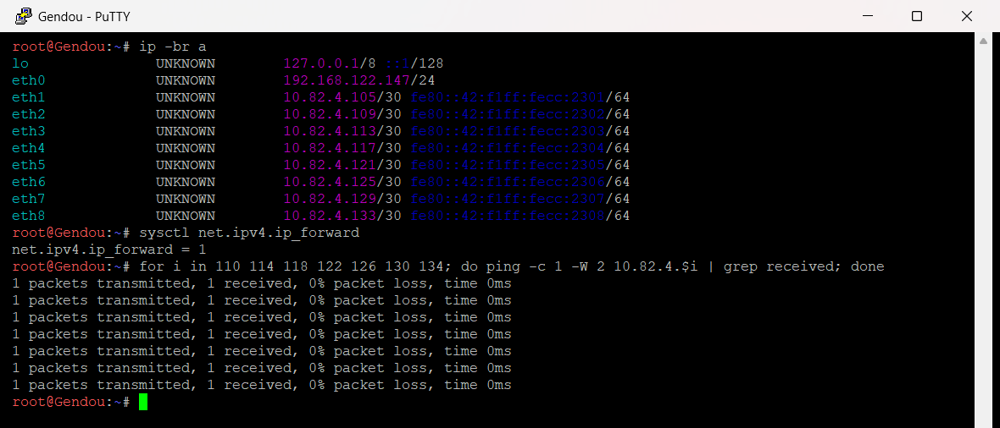

<details>
<summary>Router lain (Yui, Fuyutsuki, Asuka, Hikari, Shigeru, Kaji, Misato, Mari, Rei, Shinji, Maya, Toji, Kaworu, Kensuke, Ritsuko, Makoto)</summary>

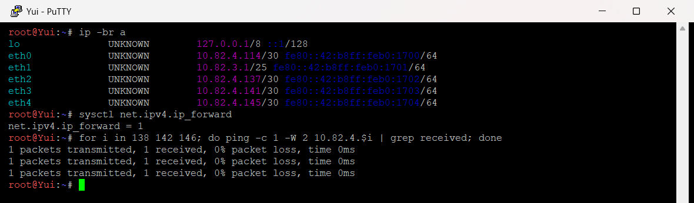

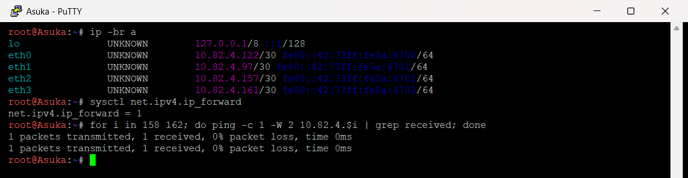

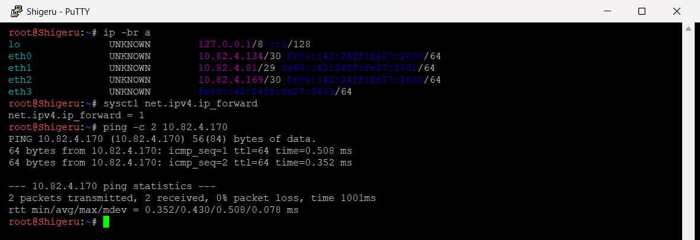
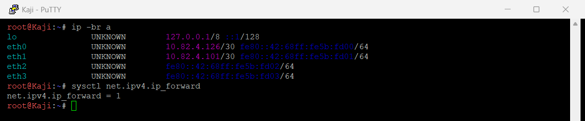


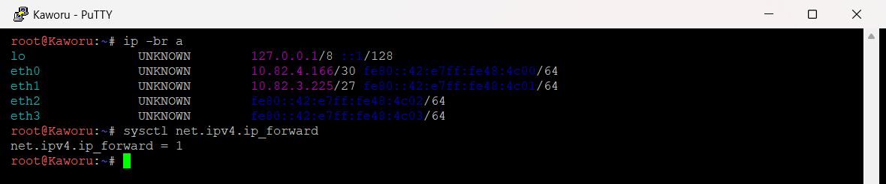


</details>

---

## Soal 3 — Routing statis dengan rute minimal

Prinsipnya: router selain Gendou cukup punya **satu default route ke atas** ditambah rute ke subnet yang ada di
bawahnya lewat router lain. Router ujung (Kaji, Misato, Mari, Rei, Shinji, Maya, Toji, Kaworu, Kensuke,
Ritsuko, Makoto) hanya punya default route. Subnet yang menempel langsung di interface tidak perlu rute.

Summarization dicek per cabang Gendou. Satu-satunya cabang yang subnet-nya bisa digabung **tepat** menjadi
satu CIDR adalah Shigeru: Switch-Monolith `10.82.4.80/29` + Switch-Radar `10.82.4.88/29` = `10.82.4.80/28`
(blok /28 utuh, tidak ada alamat milik cabang lain di dalamnya). Cabang lain tidak bisa diringkas karena
bloknya tidak berdampingan; misalnya Terminal `4.56/29` dan Dogma `4.72/29` di cabang Fuyutsuki dipisah oleh
Cage `4.64/29` milik Misato.

| Router | Rute |
|:---|:---|
| Gendou | default dari DHCP NAT1; Fuyutsuki `.110`: 4.56/29, 3.192/27, 4.72/29, 4.148/30, 4.152/30; Yui `.114`: 3.0/25, 4.32/28, 0.0/23, 4.0/27, 4.136/30, 4.140/30, 4.144/30; Hikari `.118`: 2.0/24, 3.224/27, 4.164/30; Asuka `.122`: 4.96/30, 3.128/26, 4.48/29, 4.156/30, 4.160/30; Kaji `.126`: 4.100/30; Misato `.130`: 4.64/29; Shigeru `.134`: **4.80/28** (ringkasan), 4.168/30 |
| Yui | default via .113; 4.32/28 via .138; 0.0/23 via .142; 4.0/27 via .146 |
| Fuyutsuki | default via .109; 3.192/27 via .150; 4.72/29 via .154 |
| Asuka | default via .121; 3.128/26 via .158; 4.48/29 via .162 |
| Hikari | default via .117; 3.224/27 via .166 |
| Shigeru | default via .133; 4.88/29 via .170 |
| Router ujung | hanya default ke router di atasnya |

Node uji di luar cabang kiri dan atas (Armisael, Zeruel, Lilith, Magi-casper) diberi IP **sementara**
lewat `ip addr add` / `ip route replace default`, tanpa menulis file, sehingga konfigurasi permanen mereka
tetap mengikuti soal 6.

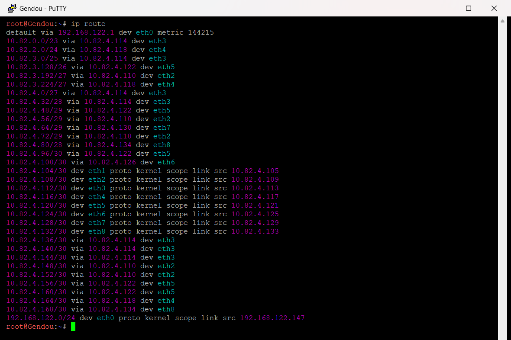
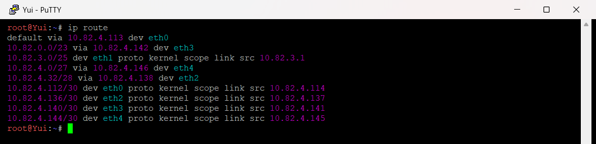


Armisael berhasil ping Lilith, Sachiel, dan Comm-Net:


---

## Soal 4 — NAT dan DNS

Di Gendou:

```bash
iptables -t nat -A POSTROUTING -s 10.82.0.0/16 -o eth0 -j MASQUERADE
```

- `MASQUERADE` memakai alamat `eth0` yang sedang aktif saat paket keluar, jadi rule tidak perlu diubah kalau
  IP dari NAT1 berganti (berbeda dengan `SNAT --to-source <ip>` yang menulis IP mati).
- `-s 10.82.0.0/16 -o eth0` membatasi agar hanya trafik dari prefix internal yang keluar lewat NAT1 yang
  diterjemahkan. Trafik antar-LAN tidak lewat `eth0`, jadi tetap membawa alamat asli pengirimnya.
- DNS memakai nameserver yang diberikan DHCP NAT1 ke Gendou (`192.168.122.1`). Semua router dan host menulis
  `nameserver 192.168.122.1` ke `/etc/resolv.conf`, sehingga node yang nanti memasang paket bisa me-resolve
  domain.

Counter MASQUERADE di-nol-kan dulu, lalu Armisael dan Lilith ping `8.8.8.8` dan `deb.debian.org`:


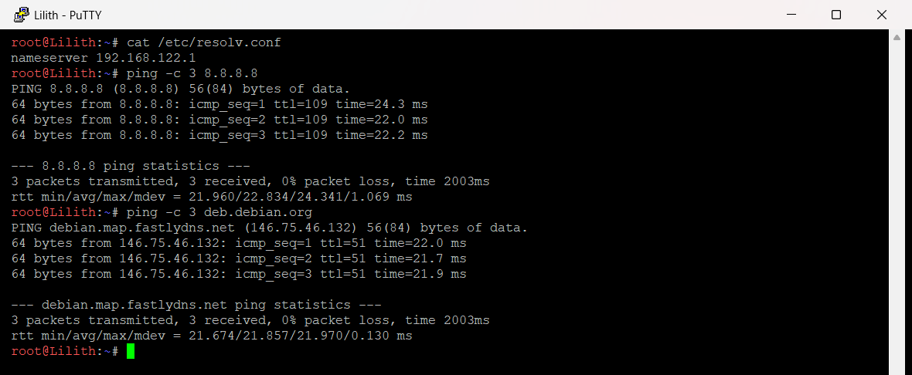

Counter rule NAT naik setelah pengujian:


---

## Soal 5 — Firewall Gendou

Seluruh konfigurasi Gendou (IP, forwarding, DHCP, rute, NAT, firewall) ada di satu file
`/root/gendou.sh`. Rule izin ditulis dulu, baru policy diubah ke `DROP`, supaya sesi console tidak
terputus di tengah jalan:

```bash
iptables -A INPUT -i lo -j ACCEPT                                          # loopback
iptables -A INPUT -m conntrack --ctstate ESTABLISHED,RELATED -j ACCEPT     # (a) balasan ke Gendou
iptables -A INPUT -i eth0 -p udp --sport 67 --dport 68 -j ACCEPT           # DHCP dari NAT1
iptables -A INPUT -s 10.82.0.0/16 -j ACCEPT                                # (d) internal ke Gendou

iptables -A FORWARD -m conntrack --ctstate ESTABLISHED,RELATED -j ACCEPT   # (a) balasan koneksi
iptables -A FORWARD -s 10.82.0.0/16 -o eth0 -j ACCEPT                      # (b) internal ke internet
iptables -A FORWARD -s 10.82.0.0/16 -d 10.82.0.0/16 -j ACCEPT              # (c) antar-LAN

iptables -P INPUT DROP
iptables -P FORWARD DROP
```

Koneksi baru dari sisi NAT1 tidak cocok dengan rule mana pun, jadi jatuh ke policy `DROP` (counter
`policy DROP` di INPUT terlihat naik). Balasan dari internet tetap lolos lewat rule `ESTABLISHED,RELATED`.


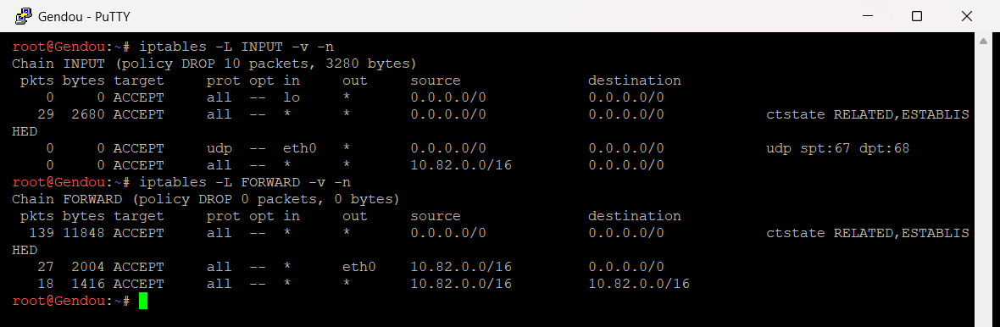

---

## Soal 6 — IP statis permanen

IP disimpan di `/etc/network/interfaces` (sama dengan *Edit network configuration* di GNS3) dan dijalankan
oleh `ifup -a` saat container start, jadi bertahan setelah restart. Contoh Unit-01:

```
auto eth0
iface eth0 inet static
	address 10.82.4.66
	netmask 255.255.255.248
	gateway 10.82.4.65
	up echo nameserver 192.168.122.1 > /etc/resolv.conf
```

### Cabang kiri dan atas

| Node | Switch | IP | Netmask | Gateway |
|:---|:---|:---|:---|:---|
| Quarters | Switch-Quarters | 10.82.0.2 | 255.255.254.0 | 10.82.0.1 |
| Comm-Net | Switch-Comm | 10.82.2.2 | 255.255.255.0 | 10.82.2.1 |
| Hangar-Crew | Switch-Hangar | 10.82.3.2 | 255.255.255.128 | 10.82.3.1 |
| Sachiel | Switch-Bunker | 10.82.3.130 | 255.255.255.192 | 10.82.3.129 |
| Relay-Node | Switch-Relay | 10.82.3.226 | 255.255.255.224 | 10.82.3.225 |
| Garden-Staff | Switch-Garden | 10.82.4.2 | 255.255.255.224 | 10.82.4.1 |
| Dock-Crew | Switch-Dock | 10.82.4.34 | 255.255.255.240 | 10.82.4.33 |
| Entry-Plug | Switch-Lab | 10.82.4.50 | 255.255.255.248 | 10.82.4.49 |
| Dummy-Plug | Switch-Lab | 10.82.4.51 | 255.255.255.248 | 10.82.4.49 |
| Archieve-Vault | Switch-Archive | 10.82.4.98 | 255.255.255.252 | 10.82.4.97 |
| Spy | Switch-Intel | 10.82.4.102 | 255.255.255.252 | 10.82.4.101 |
| Unit-01 | Switch-Cage | 10.82.4.66 | 255.255.255.248 | 10.82.4.65 |
| Unit-02 | Switch-Cage | 10.82.4.67 | 255.255.255.248 | 10.82.4.65 |
| Unit-00 | Switch-Cage | 10.82.4.68 | 255.255.255.248 | 10.82.4.65 |

Unit-01 di-restart (stop lalu start). `ELAPSED` PID 1 menunjukkan container baru saja menyala, tetapi IP dan
gateway tetap terpasang dan ping ke gateway berhasil:


### Cabang kanan dan tengah

Koneksi `eth0` pada 11 host sudah cocok dengan topologi GNS3. Berkas di bawah disiapkan
untuk `/etc/network/interfaces` sesuai spreadsheet VLSM.

| Node | Switch | IP | Netmask | Gateway |
|:---|:---|:---|:---|:---|
| [Pen-Pen](configs/host/Pen-Pen.interfaces) | Switch-Medic | 10.82.3.194 | 255.255.255.224 | 10.82.3.193 |
| [Medic-Bay](configs/host/Medic-Bay.interfaces) | Switch-Medic | 10.82.3.195 | 255.255.255.224 | 10.82.3.193 |
| [Magi-casper](configs/host/Magi-casper.interfaces) | Switch-Terminal | 10.82.4.58 | 255.255.255.248 | 10.82.4.57 |
| [Magi-Balthasar](configs/host/Magi-Balthasar.interfaces) | Switch-Terminal | 10.82.4.59 | 255.255.255.248 | 10.82.4.57 |
| [Magi-Melchior](configs/host/Magi-Melchior.interfaces) | Switch-Terminal | 10.82.4.60 | 255.255.255.248 | 10.82.4.57 |
| [Lilith](configs/host/Lilith.interfaces) | Switch-Dogma | 10.82.4.74 | 255.255.255.248 | 10.82.4.73 |
| [Adam](configs/host/Adam.interfaces) | Switch-Dogma | 10.82.4.75 | 255.255.255.248 | 10.82.4.73 |
| [Zeruel](configs/host/Zeruel.interfaces) | Switch-Monolith | 10.82.4.82 | 255.255.255.248 | 10.82.4.81 |
| [Armisael](configs/host/Armisael.interfaces) | Switch-Monolith | 10.82.4.83 | 255.255.255.248 | 10.82.4.81 |
| [Radar-Array](configs/host/Radar-Array.interfaces) | Switch-Radar | 10.82.4.90 | 255.255.255.248 | 10.82.4.89 |
| [Tokyo3-Core](configs/host/Tokyo3-Core.interfaces) | Switch-Cmd | 10.82.4.106 | 255.255.255.252 | 10.82.4.105 |

Konfigurasi 11 host disimpan melalui klien GNS3 Desktop saat masing-masing container berhenti.
Setiap file dibaca ulang dari controller dan dicocokkan dengan konfigurasi yang disiapkan.
Saat koneksi tulis terputus, hasil pembacaan ulang digunakan untuk menentukan apakah file sudah
tersimpan sebelum melanjutkan.

**Uji nyala Pen-Pen.** Sesudah node dinyalakan, `ip -br -4 addr show dev eth0` dan
`ip -4 route show default dev eth0` menghasilkan:

```text
eth0             UNKNOWN        10.82.3.194/27
default via 10.82.3.193
```

Pen-Pen dikembalikan ke kondisi berhenti setelah pengujian. Uji nyala Medic-Bay tertahan karena
GNS3 mengembalikan HTTP `409` dengan pesan Docker `404 No such container`. File konfigurasi
Medic-Bay sudah tersimpan dan cocok saat dibaca ulang.

---

## Soal 7 — Layanan MAGI

Soal ini menyiapkan tiga node MAGI untuk menerima pesan TCP dari Lilith. [Skrip MAGI](configs/host/magi.sh)
memeriksa `iptables` dan `netcat-openbsd`, memasang paket jika diperlukan, lalu membuka listener sesuai
nama skrip di container. Opsi `-k` mempertahankan listener setelah satu sesi selesai. Pesan masuk
dicatat di `/var/log/magi-<port>.log`.

| Node | IP | Port TCP | Nama skrip di container |
|:---|:---|:---|:---|
| Magi-casper | `10.82.4.58` | `5000` | `/root/magi-casper.sh` |
| Magi-Balthasar | `10.82.4.59` | `5000`, `5001` | `/root/magi-balthasar.sh` |
| Magi-Melchior | `10.82.4.60` | `5000` | `/root/magi-melchior.sh` |

Ketiga node semula gagal menyala dengan HTTP `409` dan pesan Docker `404 No such container`.
Setiap container pengganti diuji nyala dan konfigurasi IP-nya dicocokkan sebelum node lama
dilepas. Casper, Balthasar, dan Melchior dikembalikan ke port 1, 2, dan 3 `Switch-Terminal`.
Topologi setelah pemulihan berisi 60 node dan 59 link. Keempat listener berhasil dibuka di GNS3.

Uji awal antar-node MAGI berhasil pada keempat port. Untuk uji antarsubnet, container Lilith, Toji,
dan Fuyutsuki yang juga mengalami `404 No such container` dipulihkan ke sambungan aslinya.
Skrip [Fuyutsuki](configs/router/fuyutsuki.sh) dan [Toji](configs/router/toji.sh) yang tersimpan
dijalankan kembali. Keduanya menunjukkan `net.ipv4.ip_forward = 1`. Rute dari Toji ke Terminal
melewati `10.82.4.153`, dan rute balik dari Fuyutsuki ke Dogma melewati `10.82.4.154`.

Lilith (`10.82.4.74/29`) mengirim empat pesan lewat gateway `10.82.4.73`. GNS3 menunjukkan
status `LISTEN` pada setiap port tujuan dan pesan berikut pada log penerima.

| Pengirim | Penerima | TCP | Pesan yang terlihat di log penerima |
|:---|:---|:---|:---|
| Lilith | Magi-casper | `5000` | `soal7-lilith-casper-5000` |
| Lilith | Magi-Balthasar | `5000` | `soal7-lilith-balthasar-5000` |
| Lilith | Magi-Balthasar | `5001` | `soal7-lilith-balthasar-5001` |
| Lilith | Magi-Melchior | `5000` | `soal7-lilith-melchior-5000` |

Contoh uji di console Lilith untuk Casper.

```bash
printf '%s\n' 'soal7-lilith-casper-5000' | nc.openbsd -N -w 3 10.82.4.58 5000
```

Periksa hasilnya di console Casper.

```bash
grep -Fx 'soal7-lilith-casper-5000' /var/log/magi-5000.log
```

---

## Soal 9 — Sabotase routing di Shigeru

`break_routing.sh` dijalankan langsung oleh praktikan di console Shigeru **tanpa membaca isinya**. Diagnosis
hanya dari gejala dan perbandingan state.

### Persiapan

1. Rule soal 18–19 di Shigeru dilepas sementara (`iptables -F INPUT/FORWARD/OUTPUT`), supaya Shigeru dalam
   kondisi soal 2–6 dan uji "Lilith ping Armisael" bermakna.
2. Kondisi normal dicatat: Lilith ping Armisael berhasil.

   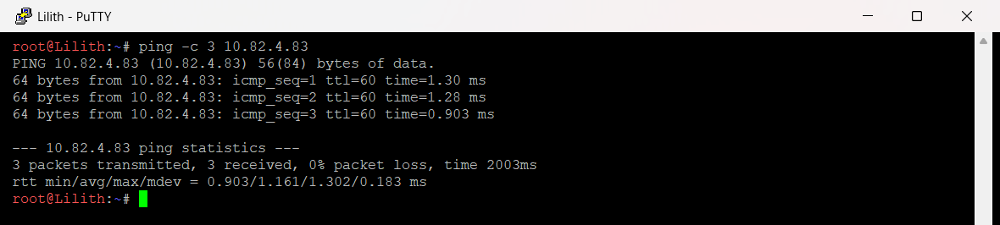
3. Baseline Shigeru disimpan dengan `bash /root/snapshot.sh /root/baseline.txt`. Isinya: `ip -br link/addr`,
   semua tabel rute, `ip rule`, sysctl `ip_forward` / `rp_filter` / redirect / `proxy_arp` per interface,
   `tc qdisc`, `iptables -S` untuk tabel `raw`, `mangle`, `nat`, `filter`, `nft list ruleset`, dan `ip neigh`.

### Gejala

Setelah `break_routing.sh` dijalankan, Lilith tidak bisa lagi ping Armisael (100% loss):


### Diagnosis

```bash
bash /root/snapshot.sh /root/after.txt
diff /root/baseline.txt /root/after.txt     # tanda < = baseline, > = sesudah sabotase
```


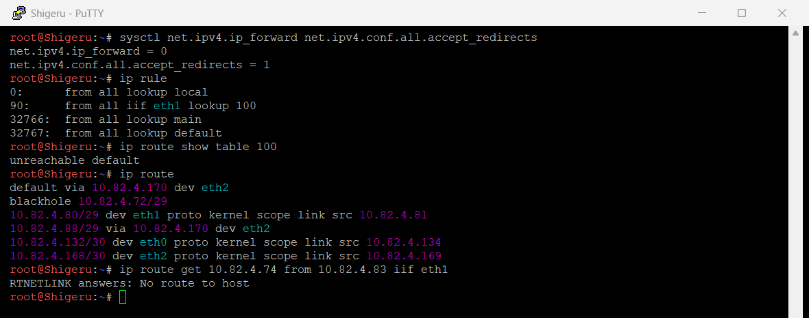

Ada lima perubahan, semuanya di Shigeru:

| # | Perubahan | Akibat | Arah yang putus |
|---|---|---|---|
| 1 | `ip_forward` dan `conf.*.forwarding` jadi `0` | Shigeru berhenti meneruskan paket antar-interface | pergi dan balik |
| 2 | `ip rule` pref 90: `from all iif eth1 lookup 100`, tabel 100 hanya berisi `unreachable default` | semua paket yang masuk dari Monolith (`eth1`) dijawab *unreachable*, tidak pernah sampai ke tabel `main` | balik |
| 3 | `blackhole 10.82.4.72/29` di tabel `main` | paket menuju Switch-Dogma (subnet Lilith) dibuang | balik |
| 4 | default route pindah dari `via 10.82.4.133 dev eth0` (Gendou) ke `via 10.82.4.170 dev eth2` (Makoto) | Makoto juga ber-default ke Shigeru, jadi paket ke luar zona berputar Shigeru ↔ Makoto sampai TTL habis | balik (dan semua trafik keluar zona) |
| 5 | `net.ipv4.conf.all.accept_redirects` jadi `1` | tidak memutus ping, tetapi router jadi mau mengubah rutenya karena ICMP redirect dari luar | — (celah) |

**Arah pergi vs arah balik.** Request Lilith → Armisael masuk Shigeru lewat `eth0` lalu harus diteruskan
ke `eth1`. Arah ini hanya diputus oleh perubahan #1. Reply Armisael → Lilith masuk lewat `eth1`, dan arah ini
diputus tiga kali sekaligus. Pertama rule #2 membuatnya *unreachable*. Kalau rule itu dihapus, blackhole #3
membuangnya. Kalau blackhole juga dihapus, default #4 melemparnya ke Makoto yang mengembalikannya lagi ke
Shigeru.

Karena itu, menyalakan forwarding saja **belum cukup**. Pada percobaan ini forwarding sudah `1`, jalur pergi
sudah benar, tetapi `ip route get 10.82.4.74 from 10.82.4.83 iif eth1` masih `No route to host` dan ping
tetap gagal karena balasannya tidak bisa pulang:


### Perbaikan

Jalur balik dibersihkan, redirect dimatikan lagi, lalu `ip route get` untuk arah balik sudah keluar lewat
`eth0` ke Gendou:


Lilith kembali bisa ping Armisael:

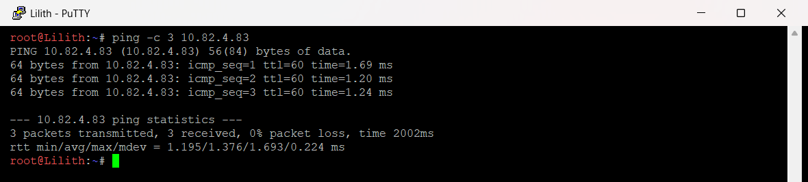

Perbaikan dimasukkan ke `/root/shigeru.sh` ([configs/router/shigeru.sh](configs/router/shigeru.sh)),
sehingga menjalankan ulang script langsung membersihkan sabotase yang sama:

```bash
sysctl -w net.ipv4.ip_forward=1                     # sekaligus forwarding semua interface
sysctl -w net.ipv4.conf.all.accept_redirects=0
while ip rule del lookup 100 2>/dev/null; do :; done
ip route flush table 100 2>/dev/null
ip route del blackhole 10.82.4.72/29 2>/dev/null
ip route replace default via 10.82.4.133 dev eth0
```

Setelah verifikasi, `bash /root/shigeru.sh` dijalankan penuh sehingga rule soal 18–19 terpasang lagi. Rute
dan sysctl sudah sama dengan baseline, dan tabel 100 kosong. Lilith → Armisael kembali tertutup, tetapi
sekarang karena isolasi soal 19 yang memang disengaja, bukan karena sabotase.


---

## Soal 10 — Sabotase NAT di Misato dan Gendou

Kondisi normal sebelum sabotase: Unit-01 (Cage) dan Spy (Intel) sama-sama bisa ping `8.8.8.8`.


Baseline Misato dan Gendou disimpan di `/root/baseline.txt` masing-masing (termasuk tabel `nat`, `mangle`,
`raw`). `break_nat.sh` lalu dijalankan praktikan di kedua node tanpa membaca isinya.

### Gejala

Counter NAT dan filter di Misato dan Gendou dinolkan (`iptables -Z`). Setelah itu Unit-01 gagal ke internet,
sedangkan Spy tetap normal:

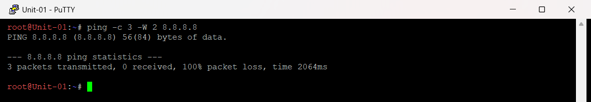


### Diagnosis

Diff Misato hanya berisi satu rule baru di `nat POSTROUTING`. `172.31.99.1` bukan alamat Misato maupun
alamat mana pun di topologi:

```
-A POSTROUTING -s 10.82.4.64/29 ! -d 10.82.0.0/16 -o eth0 -j SNAT --to-source 172.31.99.1
```

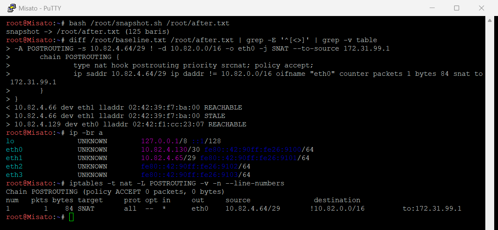

Diff Gendou berisi satu rule `RETURN` yang disisipkan **di atas** MASQUERADE (selain itu hanya counter):

```
-A POSTROUTING -s 10.82.4.64/29 -o eth0 -j RETURN
```


**Siapa yang melakukan source NAT?** Hanya **Gendou**, lewat MASQUERADE di `eth0` (NAT1). Misato adalah
router ujung untuk Switch-Cage dan seharusnya tidak melakukan NAT sama sekali, karena tabel `nat`-nya di
baseline kosong. Counter setelah dinolkan membuktikannya:

| Counter | Nilai | Artinya |
|---|---|---|
| Misato `SNAT` | 1 paket | paket pertama ping Unit-01 diganti sumbernya jadi `172.31.99.1` (paket berikutnya ikut entri conntrack) |
| Gendou `FORWARD` policy DROP | 3 paket, 252 byte | ketiga ping Unit-01 (3 × 84 byte) ditolak firewall soal 5 karena sumber `172.31.99.1` tidak cocok `-s 10.82.0.0/16` |
| Gendou `RETURN` | 0 | paket Cage tidak pernah sampai di sini, sudah dibuang di FORWARD |
| Gendou `MASQUERADE` | 1 paket | ping Spy, diterjemahkan normal oleh Gendou |

**Kenapa Cage terdampak tapi Intel tidak?** Kedua rule sabotase hanya mencocokkan `-s 10.82.4.64/29`, yaitu
Switch-Cage (Unit-00/01/02) yang ada di belakang Misato. Switch-Intel (`10.82.4.100/30`, Spy) ada di belakang
Kaji, tidak melewati Misato, dan tidak cocok dengan rule `RETURN`, jadi tetap di-MASQUERADE Gendou seperti biasa.

Kedua sabotase **berdiri sendiri** dan harus diperbaiki semua:

- Kalau hanya Misato yang diperbaiki, paket Cage sampai di Gendou dengan sumber `10.82.4.66`, tetapi rule
  `RETURN` membuatnya keluar NAT1 **tanpa** diterjemahkan. NAT1 tidak tahu rute ke `10.82.x.x`, jadi balasan
  tidak kembali.
- Kalau hanya Gendou yang diperbaiki, sumber `172.31.99.1` tetap ditolak FORWARD Gendou. Kalaupun lolos,
  balasan ke `172.31.99.1` tidak punya jalan pulang.

### Perbaikan

`/root/misato.sh` ([configs/router/misato.sh](configs/router/misato.sh)) sekarang mengosongkan
`nat POSTROUTING`, karena Misato bukan titik NAT:

```bash
iptables -t nat -F POSTROUTING
```

`/root/gendou.sh` ([configs/router/gendou.sh](configs/router/gendou.sh)) memang sudah menulis ulang tabel
`nat` dari nol (`iptables -t nat -F`) sebelum memasang satu-satunya rule MASQUERADE, sehingga `RETURN`
sisipan ikut terbuang. Komentar di script mencatat bahwa tidak boleh ada pengecualian sebelum MASQUERADE.
Rule firewall soal 5 (policy DROP, aturan INPUT/FORWARD) tetap utuh:


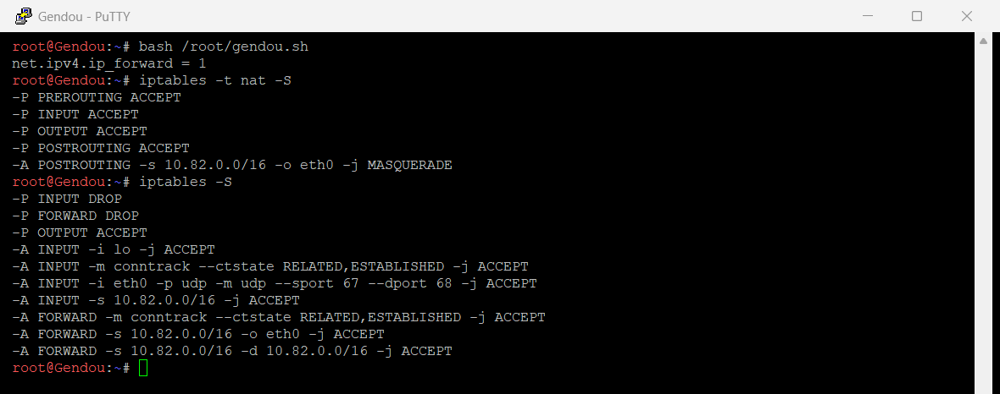

Unit-01 dan Spy sama-sama bisa ke internet lagi. MASQUERADE Gendou (counter baru di-reset oleh script)
sekarang menghitung paket keduanya, sedangkan `nat` Misato kosong:


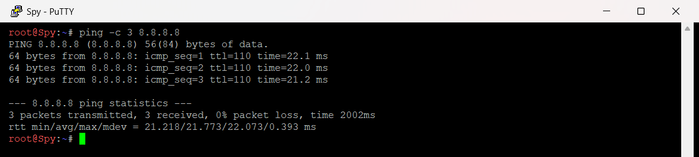
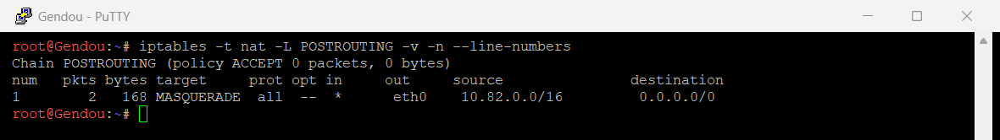


---

## Soal 18 — Gerbang Monolith dan Radar (Shigeru)

Zona sensitif berada di belakang Shigeru: Switch-Monolith (`eth1`) dan Switch-Radar (lewat `eth2` → Makoto).
Semua trafik dari luar zona pasti masuk Shigeru lewat **`eth0`** (sisi yang menghadap Gendou), jadi
penyaringan cukup berdasarkan interface masuk, tanpa menulis daftar subnet luar. Subnet baru apa pun
otomatis ikut terblokir.

```bash
iptables -A FORWARD -m conntrack --ctstate ESTABLISHED,RELATED -j ACCEPT                    # balasan untuk koneksi dari dalam zona
iptables -A FORWARD -i eth0 -s 10.82.4.56/29 -p icmp --icmp-type echo-request -j ACCEPT     # pengecualian: ping dari Terminal
iptables -A FORWARD -i eth0 -m conntrack --ctstate NEW -j DROP                             # koneksi baru dari luar ditolak
```

Koneksi yang dimulai dari dalam zona keluar lewat `eth0` (bukan masuk), jadi tidak kena rule DROP, dan
balasannya lolos lewat `ESTABLISHED,RELATED`.

Ping Casper (Terminal) ke Zeruel berhasil:

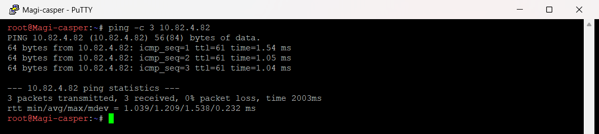

Ping (dan TCP) Lilith ke Zeruel gagal:


Dari dalam zona tetap bebas keluar:


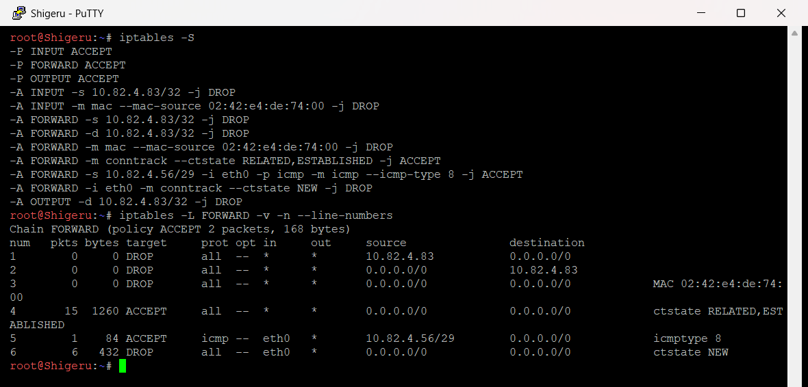

---

## Soal 19 — Isolasi Armisael

Tidak ada satu pun rule yang dipasang di Armisael. Isolasi dikerjakan di dua titik:

1. **Shigeru** (`/root/shigeru.sh`). Semua trafik Armisael ke gateway, ke luar switch, dan ke internet
   melewati Shigeru. Rule diletakkan **paling atas**, di atas `ESTABLISHED,RELATED` dan pengecualian ping
   Terminal, supaya tidak ada celah. Pencocokan memakai IP dan MAC Armisael, jadi mengganti IP pun tetap
   terblokir.

   ```bash
   iptables -A INPUT   -s 10.82.4.83 -j DROP
   iptables -A INPUT   -m mac --mac-source 02:42:e4:de:74:00 -j DROP
   iptables -A OUTPUT  -d 10.82.4.83 -j DROP
   iptables -A FORWARD -s 10.82.4.83 -j DROP
   iptables -A FORWARD -d 10.82.4.83 -j DROP
   iptables -A FORWARD -m mac --mac-source 02:42:e4:de:74:00 -j DROP
   ```

2. **Zeruel** (`/root/zeruel.sh`). Armisael dan Zeruel berada di switch yang sama, jadi trafik di antara
   keduanya hanya lewat switch dan **tidak pernah melewati Shigeru**. Blokirnya dipasang di sisi Zeruel dan
   hanya menyasar Armisael, sehingga koneksi Zeruel ke tujuan lain tidak terganggu. Script ini tidak mem-flush
   iptables Zeruel; script hanya menghapus lalu memasang ulang rule miliknya sendiri.

   ```bash
   iptables -I INPUT 1  -s 10.82.4.83 -j DROP
   iptables -I INPUT 2  -m mac --mac-source 02:42:e4:de:74:00 -j DROP
   iptables -I OUTPUT 1 -d 10.82.4.83 -j DROP
   ```

Listener `nc -lk 9000 > /tmp/nc9000.log &` dinyalakan di Zeruel dan Lilith. Uji ke Seele memakai TCP 53.

Dari Armisael, semua ping dan nc gagal (Seele, Zeruel, Lilith, bahkan gateway `10.82.4.81`):

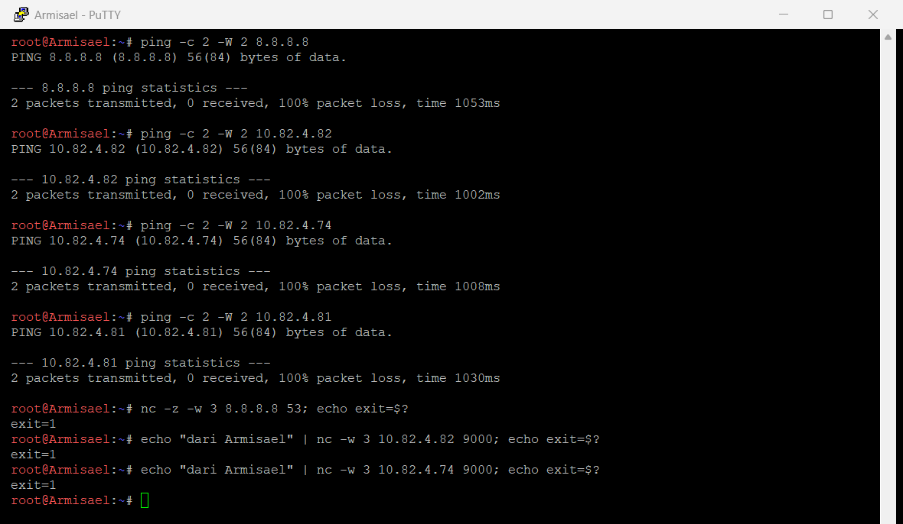

Dari Zeruel, ping dan nc ke Seele dan Lilith berhasil (dan Zeruel juga tidak bisa menjangkau Armisael):


Log listener Lilith hanya menerima pesan dari Zeruel, tidak ada pesan dari Armisael:

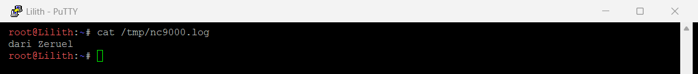

